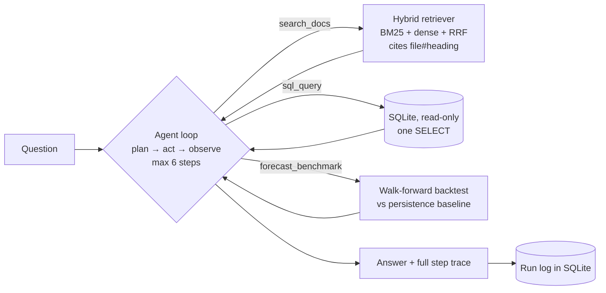

# ForecastLens: Tool-Using AI Research Agent

A framework-free LLM agent (plan → act → observe loop, 6-step cap) with three tools, served over a FastAPI REST API. Its answers are meant to be checkable: claims come with a cited passage, a SQL result, or a forecasting backtest, and the agent states plainly when a model **fails to beat the persistence baseline**.

It runs **offline with no API key** (a deterministic rule-based planner stands in for the LLM) and switches to a real model (Claude, OpenAI, or any OpenAI-compatible endpoint such as Gemini's compatibility API or Ollama) through environment variables.



## The three tools

| Tool | What it does |
|---|---|
| `search_docs` | Hybrid retrieval (BM25 from scratch + dense LSA vectors, fused with Reciprocal Rank Fusion). Returns top-k passages as `[file#heading]`, e.g. `[forecast_validation#walk-forward-validation]` |
| `sql_query` | One read-only `SELECT` on `sales` and `weekly_units`. Rejects writes, multiple statements and non-SELECT text, caps rows, and the connection is also `PRAGMA query_only` |
| `forecast_benchmark` | Walk-forward (expanding window, no look-ahead) backtest of `seasonal_naive`, `moving_average`, `drift` and `ar` against persistence, with a 95% block-bootstrap interval on the error gain and a verdict: **beats**, **worse**, or **does not beat (not distinguishable from zero)** |

Example (`north_units`, 4 weeks ahead, 52 test points):

```
model          | MAE   | MAE vs persistence | gain % | 95% CI of MAE gain
persistence    | 31.32 | 1.00               |  0.0   | -
seasonal_naive | 36.98 | 1.18               | -18.1  | [-16.53, +5.63]
moving_average | 39.76 | 1.27               | -27.0  | [-13.66, -3.62]
drift          | 31.10 | 0.99               |  +0.7  | [-2.72, +3.03]
ar             | 19.50 | 0.62               | +37.7  | [+3.89, +20.09]
VERDICT: ar BEATS the persistence baseline.  seasonal_naive and drift do NOT beat it.
```

On `west_units` (a random walk) nothing beats persistence at 1 week, and the agent says so. **The data is synthetic** (`data/weekly_units.csv`, generated for this demo), so these numbers show the method works, not anything about real demand.

## API (5 endpoints)

| Endpoint | Purpose |
|---|---|
| `GET /health` | Liveness check (public) |
| `POST /search` | Top-k passages with citations; `mode` is `bm25`, `dense` or `hybrid` |
| `POST /ask` | Run the agent; returns the answer, status, tools used and every step |
| `GET /runs` | Recent runs |
| `GET /runs/{id}` | One run with its full trace |

Request bodies are Pydantic-validated (invalid input returns 422). If `API_KEY` is set, all endpoints except `/health` require `X-API-Key`, compared in constant time (`hmac.compare_digest`).

## Quick start

```bash
pip install -e ".[dev]"
pytest -q
python -m forecastlens ask "Does an autoregressive model beat persistence for north units 4 weeks ahead?" --trace
python -m forecastlens ask "Which region had the highest revenue?"
python -m forecastlens ask "What is walk-forward validation?"
python -m forecastlens eval
uvicorn forecastlens.api:create_app --factory --reload   # http://localhost:8000/docs
```

```bash
curl -s localhost:8000/ask -H 'content-type: application/json' \
  -d '{"question": "Can any model beat persistence on west units?"}'
```

### Use a real LLM

```bash
export LLM_PROVIDER=anthropic LLM_MODEL=<model id> LLM_API_KEY=...
# or: LLM_PROVIDER=openai LLM_MODEL=gpt-4o-mini LLM_API_KEY=... [LLM_BASE_URL=...]
```

The agent never trusts the model: each reply must parse as a JSON decision; malformed output is fed back for a retry; unknown tools, bad arguments and tool errors become observations; repeated identical calls are not re-executed; the run ends at 6 steps. The system prompt tells the model to state whether each forecast model beat persistence.

### Docker

```bash
docker build -t forecastlens . && docker run -p 8000:8000 forecastlens
```

## Evaluation (`evals/results.md`)

- **Retrieval**, 33 hand-written paraphrased questions: BM25, dense and hybrid all score hit@3 = 1.000 and MRR = 0.980. That is a ceiling effect: the corpus is only 12 short documents, so this set cannot separate the three. It is a regression test, not evidence that hybrid retrieval helps. One earlier failure (`queries` vs `query`) led to a stemmer fix, so the set was used during development.
- **Agent**, 15 questions: scored with the offline rule-based planner, so a perfect score shows the plumbing and tool routing work, not that an LLM does well. Run it with a real model to measure the model.

## Tests

`pytest` covers chunking and citation keys, BM25 and RRF, tool guardrails (SQL write attempts, bad arguments), the forecasting code (known forecasts, no-look-ahead check, a seasonal series that seasonal-naive beats and a random walk it doesn't), the agent loop with a scripted fake LLM (malformed JSON, unknown tool, duplicate call, step cap, backend failure), the run store, the CLI, and the API (skipped automatically if FastAPI isn't installed). CI also runs the evaluation and a Docker smoke test.

## Limitations

- The vector index is an in-memory NumPy matrix with exact search. For real scale, swap it for pgvector, Chroma or Qdrant behind `Retriever.search`. `SentenceTransformerEmbedder` (`pip install -e ".[neural]"`) replaces the LSA embedder.
- The hosted-LLM backends and the sentence-transformers adapter are not covered by automated tests, which avoid network calls.
- The forecasting models are deliberately simple, and the bootstrap treats errors as weakly dependent (4-week blocks), which is approximate.
- The offline planner only recognises digits for horizons ("4 weeks", not "four weeks").
- The SQL keyword filter is conservative: it would also reject a query using `REPLACE()`.
