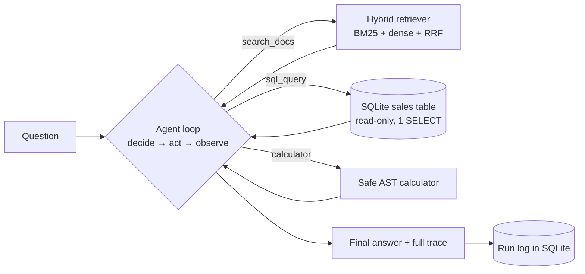

# Agentic RAG Lab

A small, fully tested **hybrid-retrieval RAG service with a tool-using agent**, served over a FastAPI REST API, with an evaluation harness that reports results the way a forecaster would: against baselines, with sample sizes and confidence intervals.

It runs **offline with no API key** (a deterministic rule-based planner stands in for the LLM), and switches to a real model (Claude, OpenAI, or any OpenAI-compatible endpoint such as Gemini's compatibility API or Ollama) by setting environment variables.

## What's inside



| Piece | File | Notes |
|---|---|---|
| Chunking | `chunking.py` | Paragraph packing with word overlap |
| BM25 | `retrieval.py` | Implemented from scratch |
| Dense search | `embeddings.py`, `retrieval.py` | TF-IDF + SVD (LSA) offline; optional sentence-transformers adapter |
| Hybrid ranking | `retrieval.py` | Reciprocal Rank Fusion (k = 60) |
| Agent | `agent.py` | Step cap, duplicate-call guard, malformed-output recovery, tool-error feedback |
| Tools | `tools.py` | Document search, read-only SQL, AST-based calculator (no `eval`) |
| LLM backends | `llm.py` | Offline planner, Anthropic Messages API, OpenAI-compatible chat |
| API | `api.py` | FastAPI, Pydantic validation, optional `X-API-Key` auth, health check |
| Persistence | `store.py` | Every run and its trace saved to SQLite |
| Evaluation | `evaluate.py`, `evals/qa_set.json` | hit@k, MRR, paired bootstrap CI, agent tool-selection checks |
| Quality gates | `tests/`, `.github/workflows/ci.yml` | pytest, ruff, eval run and Docker smoke test in CI |

## Quick start

```bash
pip install -e ".[dev]"
pytest -q                                   # unit + API tests
python -m agentic_rag ask "What is the total revenue in the North region, and what is 15% of that?" --trace
python -m agentic_rag search "how do I merge two ranked lists" --mode hybrid
python -m agentic_rag eval                  # retrieval + agent evaluation
uvicorn agentic_rag.api:create_app --factory --reload   # http://localhost:8000/docs
```

```bash
curl -s localhost:8000/ask -H 'content-type: application/json' \
  -d '{"question": "Which region had the highest revenue?"}'
```

### Use a real LLM

```bash
export LLM_PROVIDER=anthropic LLM_MODEL=<model id> LLM_API_KEY=...
# or: LLM_PROVIDER=openai LLM_MODEL=gpt-4o-mini LLM_API_KEY=... [LLM_BASE_URL=...]
```

The agent never trusts the model: every reply is parsed and validated as a JSON decision; malformed output is fed back for a retry, unknown tools and bad arguments become observations, and runs end on a step limit.

### Docker

```bash
docker build -t agentic-rag-lab . && docker run -p 8000:8000 agentic-rag-lab
```

## Evaluation (latest run, `evals/results.md`)

Retrieval, 33 hand-written paraphrased questions over a 12-document corpus, document-level relevance:

| Mode | hit@3 | MRR |
|---|---|---|
| BM25 | 1.000 | 0.960 |
| Dense (LSA) | 0.939 | 0.934 |
| Hybrid (RRF) | 0.970 | 0.942 |

Hybrid minus BM25 MRR is −0.018 (95% paired-bootstrap CI −0.051 to +0.000). **Hybrid did not beat BM25 here.** That is the honest result: the corpus is tiny and the dense side is LSA, not a neural embedding, so there is little for it to add. The harness exists so this question gets answered with data when the corpus or embedder changes.

How to read these numbers:
- The question set was written by the author and used during development. One failure (`queries` vs `query` not matching) led to a stemmer fix, so BM25's score is partly tuned to this set. Treat it as a regression test, not an unbiased benchmark.
- The agent evaluation (13 questions) uses the rule-based planner, so a perfect score shows the plumbing works, not that an LLM is good at this. Run it with a real model to measure the model.

## Design decisions

- **Baselines first.** BM25 is the reference every other retriever has to beat.
- **Safety at the tool boundary.** SQL is limited to one `SELECT`, keyword-filtered, row-capped, and the connection has `PRAGMA query_only = ON` as a second layer. The calculator walks the AST and rejects everything except arithmetic.
- **Testable without an API.** The LLM is an interface; tests use a scripted fake to cover bad JSON, unknown tools, duplicate calls, tool exceptions and step limits.
- **Observability.** Every run's steps are stored and available at `GET /runs/{id}`.

## Limitations and next steps

- The vector index is an in-memory NumPy matrix with exact search. For real scale, swap it for pgvector, Chroma or Qdrant behind `Retriever.search`.
- Swap `LsaEmbedder` for `SentenceTransformerEmbedder` (`pip install -e ".[neural]"`) and re-run `eval`.
- The hosted-LLM backends and the sentence-transformers adapter are written against the public API docs but are not exercised by the automated tests, which avoid network calls.
- The agent loop is a hand-written state machine, laid out so it maps onto a LangGraph graph (decide and act as nodes, tool-or-final as the conditional edge).
- The SQL keyword filter is conservative: it would also reject a query using `REPLACE()`.
